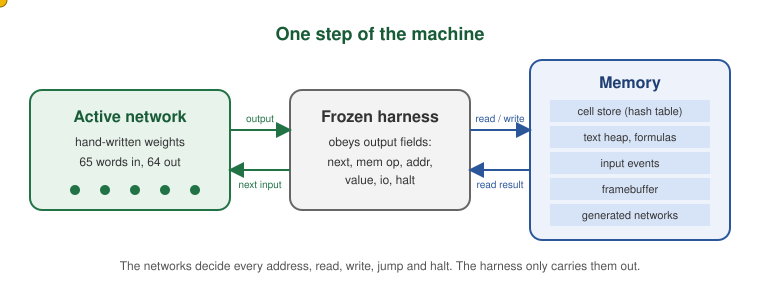
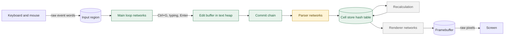

# WeightSpaceExcel

**Microsoft Excel, rebuilt entirely out of hand-written neural network weights.**

No training. No code that generates weights. Every number in every weight file is reasoned out and typed by hand, and a tiny frozen harness does nothing but run forward passes and move bytes. The spreadsheet's whole behavior (cell storage, keyboard handling, parsing, every function, formatting, charts, the GUI, VBA and file I/O) lives in the weights.

The aim is full parity with Excel, including how it looks, and to see how far weight-space programming can go. See [GOAL.md](GOAL.md) for the goal statement and [docs/](docs/) for the rules and plan.

<p align="center"></p>

## How it works

Every step, the harness runs the active network on a 65-word input and reads seven fixed fields from its 64-word output: which network runs next, a memory read or write, the address, the value, an I/O request and a halt flag. It carries those out exactly and feeds the result into the next step. All decisions (control flow, addressing, loops, calls and returns) are made by the networks. The remaining output words hold registers: a program counter, link register, return stack pointer and value registers, all defined in [encodings/control.md](encodings/control.md).



<sub>Green: built and tested. Yellow: in progress. Grey: not started.</sub>

### What a value looks like inside the machine

A cell value is two words, a type tag and a payload, defined in [encodings/value.md](encodings/value.md). Cells are found through a hash of their packed address ([encodings/address.md](encodings/address.md)).

| Tag | Type | Payload |
|---:|---|---|
| 0 | blank | 0 (unwritten memory already reads as blank) |
| 1 | number | IEEE double |
| 2 | text | handle into the text heap |
| 3 | boolean | 0 or 1 |
| 4 | error | Excel's ERROR.TYPE code |
| 5 to 8 | reference, array, lambda, missing argument | handles |

## Progress

**Current stage: 1 (core engine), with Stage 0 complete.**

```mermaid
gantt
    title Stages
    dateFormat  X
    axisFormat  %s
    section Done
    0 Foundations           :done, s0, 0, 1
    section Active
    1 Core engine           :active, s1, 1, 2
    section Planned
    2 Minimal UI            :s2, 2, 3
    3 Math, logic, text     :s3, 3, 4
    4 Lookup, dates, format :s4, 4, 5
    5 Stat, finance, eng.   :s5, 5, 6
    6 Charts, cond. format  :s6, 6, 7
    7 Data features         :s7, 7, 8
    8 File I/O              :s8, 8, 9
    9 VBA                   :s9, 9, 10
    10 Long tail            :s10, 10, 11
```



| Measure | Now |
|---|---|
| Parity checklist items passing | 0 of 1,220 |
| Stage 1 conformance cases passing | 145 of 415 run (14 skipped until `SUM` exists) |
| Hand-written networks in the manifest | 33 |
| Kernel parameters | about 5,100 |
| Compliance, kernel and primitive tests | 200 of 200 passing |
| Primitive library parameters | about 12,100 (about 10,500 of them in division, mostly zeros) |

### Built so far

- **Frozen harness** ([harness/](harness/)): about 175 lines, a fixed set of layer types (dense, ReLU, step, identity, gating multiply, slice, concat) and a plain-text weight format.
- **Kernel** ([weights/kernel/](weights/kernel/), 30 networks): boot, call and return, fault trap, the main event loop, keystroke decoding with Ctrl+G Go To, text entry straight into the heap, Enter and Delete, and a hash-table cell store with collision handling. Typing `hello` into B3 takes 60 steps from start to finish.
- **Building-block library** ([weights/prim/](weights/prim/), 13 primitives, 172 tests): integer equality and one-hot, real compare, select (two forms), floor, ceiling, truncate and both rounding modes (including Excel's half away from zero), mod 2^k, divide by a constant, 15-digit extraction, overflow-guarded add and multiply, the cell-address hash, integer division by a variable divisor, and correctly rounded floating-point division.
- **Parser** ([weights/parse/](weights/parse/), in progress): register save and restore around the parser are done; constant entry, lexer and formula parser are next.

### Checklist by category

| Category | Items | Passing |
|---|---:|---:|
| Functions | 532 | 0 |
| Formula language | 65 | 0 |
| Values and errors | 29 | 0 |
| Calculation | 25 | 0 |
| Formatting | 80 | 0 |
| Data features | 91 | 0 |
| Charts and sparklines | 74 | 0 |
| User interface | 186 | 0 |
| VBA | 100 | 0 |
| Files | 38 | 0 |

## The rules, in short

1. Every weight is written by hand. No training or search.
2. No code may generate, compute, check or suggest weights. The only code besides the harness is black-box output tests and compliance tests.
3. Networks may write other networks, if a hand-written network controls it.
4. Small, fast networks built on compact latent encodings; multi-role weights are fine when understood and documented.
5. Networks control every memory access.
6. The harness is frozen and contains no application logic.
7. Bugs are fixed only by editing weights.

Full text: [docs/RULES.md](docs/RULES.md). Every weight block has a note explaining its values, and every step and decision is logged in [log/WORKLOG.md](log/WORKLOG.md).

## Repository map

| Path | Contents |
|---|---|
| [GOAL.md](GOAL.md) | Goal statement |
| [docs/](docs/) | Rules, harness spec, parity definition, acceptance, stages, documentation conventions |
| [encodings/](encodings/) | Latent layouts: values, addresses, memory map, control, primitives, glyphs, input events |
| [harness/](harness/) | The frozen runtime and weight-file format |
| [weights/](weights/) | Hand-written networks and their notes; [MANIFEST.txt](weights/MANIFEST.txt) maps ids to files |
| [tests/](tests/) | Compliance tests and black-box output tests |
| [checklist/](checklist/) | The frozen 1,220-item parity checklist |
| [log/](log/) | Work log, decision records and per-agent progress logs |

## Running the tests

```bash
python3 -m pytest -q tests
```

<sub>This README is updated with every push to main.</sub>
